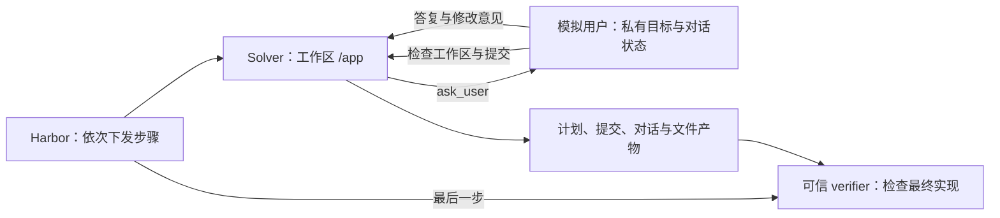

# SWE-Interact 接入调研

**建议先选 cattrs 做环境与协议预检，TOMLKit、HTTPX 作后续候选；复用 Harbor 的多步骤与 sidecar 支持，补齐我们的隔离和证据约定。** 本轮仅静态阅读源码，未安装依赖、拉取／构建镜像、运行任务或调用模型。三题尚未取得运行资格。

源码固定为 SWE-Interact `b32f98c3b8f76ca65e84341d1f30e5af7135f85d`、Harbor `c803185a8b7c88c163abe48a22e9cea0bbd95e90`（源码版本 0.24.0，Python ≥3.12）。上游 README 没有固定 Harbor 提交，因此这里核查的是当前公开组合，不代表论文当时的精确运行环境。

## 1. 它适合测什么

公开目录有 75 题：DeepSWE、SWE-bench Pro、SWE Atlas Refactoring 各 25 题。模拟用户掌握完整目标，逐步反馈；solver 在同一工作区持续修改。论文与源码入口：[论文](https://arxiv.org/abs/2606.30573)、[数据仓库](https://github.com/scaleapi/SWE-Interact/tree/b32f98c3b8f76ca65e84341d1f30e5af7135f85d)。

适合观察需求保留、反馈后的修订、回归、交接与文件接续。**不能仅凭它的计划产物证明 skill 促成了规划**：所选题目已经明确要求计划、提交和交接。我们应比较同一协议下 baseline／skill 的产物质量、落实程度与返工，功能成绩仍由 verifier 给出，过程分析单独进行。

原版 persona 会较宽松地批准初始计划，之后逐项挑出实现缺口；没有我们的人类文档偏好和设计审阅标准。因此它可以作为协作底座，不能替代完整的人类偏好验证。修改 persona 就是在改交互条件，必须另标版本，不能悄悄当作原版成绩。[persona 源码](https://github.com/scaleapi/SWE-Interact/blob/b32f98c3b8f76ca65e84341d1f30e5af7135f85d/data/multiturn/deepswe_cattrs-partial-structuring-recovery/environment/user-server/persona.md)

## 2. 实际交互与五步执行

所选三题使用相同五步结构：

| 步骤 | Agent 要做什么 | 验证含义 |
| --- | --- | --- |
| `01_plan` | 经 ask_user 澄清并取得计划认可，保存 `/tmp/plan.md`，不实施 | 中间脚本直接写 reward=1，没有检查计划质量或禁止代码修改 |
| `02_implement` | 读计划；实现和更新文档；每轮修改提交后请用户审阅，反馈后继续修改 | 中间步骤不判最终正确性；本步禁止修改测试 |
| `03_handoff` | 导出提交历史、实现 diff 和状态 | 保存实施成果 |
| `04_write_tests` | 为自己的实现另作测试提交 | 测试被刻意安排在实施后，不能用来评价是否遵循 TDD |
| `05_test_handoff` | 保存最终状态，调用可信验收 | 检查提交结构，再运行原任务测试 |

这与我们“按任务需要组织 Process”不是同一种流程定义：五步是 benchmark 自带的外部协议，不能将其固定顺序写回通用 skill。[步骤与配置](https://github.com/scaleapi/SWE-Interact/tree/b32f98c3b8f76ca65e84341d1f30e5af7135f85d/data/multiturn/deepswe_cattrs-partial-structuring-recovery)

交互分两层：步骤内通过 MCP `ask_user` 往返；步骤间由 Harbor 继续推进。所查 Harbor 的 `resume_trajectory` 默认 false，上游运行脚本没有显式开启：solver 默认各步骤新会话，靠工作区与计划接续；user-server 进程保留自己的对话列表。是否启用原生 resume 必须固定，不能混用两种设置。[Harbor 默认值](https://github.com/laude-institute/harbor/blob/c803185a8b7c88c163abe48a22e9cea0bbd95e90/src/harbor/models/trial/config.py#L102)、[多步骤实现](https://github.com/laude-institute/harbor/blob/c803185a8b7c88c163abe48a22e9cea0bbd95e90/src/harbor/trial/multi_step.py)

## 3. 模拟用户、验收和隔离

- `user-server` 是独立容器，保存 persona、完整任务目标和问答状态。它通过主容器的 `repo_exec_server` 读取最新提交与源码；它不拿隐藏 verifier。所查 server 文件在 75 题中相同。[实现](https://github.com/scaleapi/SWE-Interact/blob/b32f98c3b8f76ca65e84341d1f30e5af7135f85d/data/multiturn/deepswe_cattrs-partial-structuring-recovery/environment/user-server/server.py)
- 所选三题的最终 canonical verifier 应用可信 `test.patch`，分别运行 `base` 与 `new`，两者成功才通过。前面的 wrapper 还要求有效 base commit、干净工作区及非空的独立测试提交；随后移除 Agent 的最后测试提交再判实施结果。不能把协议失败、环境失败和功能断言失败混为同一原因。[最终 wrapper](https://github.com/scaleapi/SWE-Interact/blob/b32f98c3b8f76ca65e84341d1f30e5af7135f85d/data/multiturn/deepswe_cattrs-partial-structuring-recovery/steps/05_test_handoff/tests/test.sh)、[canonical verifier](https://github.com/scaleapi/SWE-Interact/blob/b32f98c3b8f76ca65e84341d1f30e5af7135f85d/data/multiturn/deepswe_cattrs-partial-structuring-recovery/tests/test.sh)
- Refactoring 子集包含 LLM rubric 并参与最终 reward，首轮不选，以符合我们的程序 verifier 判分约定。[RF 评价器](https://github.com/scaleapi/SWE-Interact/blob/b32f98c3b8f76ca65e84341d1f30e5af7135f85d/data/multiturn/rf_task-69391d8d1ce51c407be1e531/tests/evaluate_rubrics.py)

接入前需要处理的具体问题：

| 发现 | 接入要求 |
| --- | --- |
| 根 `instruction.md` 是完整目标，而初始步骤只要求询问用户 | solver 只接收当前步骤指令；不得沿用旧 loader 把根文件直接当初始请求 |
| task 默认公网；我们的 worker 只允许模型网关 | 分别配置 solver→ask_user、user→repo inspection、双方→各自模型的访问；不直接恢复任意外网 |
| 用户服务错误会退化为固定“请提供 diff”回复 | 保存错误与 fallback 事件，区分服务故障与用户真实纠正，不据此归因 skill 摩擦 |
| repo inspection 只检查命令名及部分 git 子命令 | `sed`／`find` 的可写或执行选项未被完整约束，命令白名单不能视为严格只读；预检应验证并收紧实际能力边界 |
| 用户日志导出使用固定 token 和同网端口 8001 | 从评测端收集日志，限制 solver 对该端口的访问，避免把旁路检查信息当正常用户反馈 |
| `/tmp/plan.md` 未配置为独立导出产物 | 显式收集计划、各步快照、提交、双方对话、用户工具记录及终止原因；不只保存最终 diff |

## 4. 三个候选

均为 DeepSWE 的程序测试任务，未发现任务设计需要生产数据库或云服务；镜像架构、安装过程和离线运行仍待验证。静态测试数量是新增函数定义数，不是运行展开后的 test case 数。

| 优先级与任务 | 功能与可观察能力 | 验收及主要限制 |
| --- | --- | --- |
| **1. cattrs：partial structuring recovery** | 部分成功结果、默认值、嵌套失败、refine 保留已成功字段；观察接口细化、反馈后保持已有行为 | 63 个新增测试定义；base 只跑 `test_errors.py`，回归范围窄；依赖未锁定 |
| **2. TOMLKit：table converters** | 表、内联表、点号键间转换，保留注释与 round-trip；观察复杂约定的持续保留 | 60 个新增测试定义；base 有明确排除项；Poetry 与基础镜像需固定 |
| **3. HTTPX：streaming JSON iteration** | 同步／异步、JSON/NDJSON/JSON-seq、编码边界、关闭与重复消费；观察需求逐步增加和资源生命周期 | 36 个新增测试定义；base 排除网络测试及一个 trio 超时用例；实现较复杂，放在链路稳定后 |

任务身份和原始要求：

- [deepswe_cattrs-partial-structuring-recovery](https://github.com/scaleapi/SWE-Interact/blob/b32f98c3b8f76ca65e84341d1f30e5af7135f85d/data/multiturn/deepswe_cattrs-partial-structuring-recovery/instruction.md)，base `6bc4708fb9b2ac52d9a18997e923da6a58916102`。
- [deepswe_tomlkit-toml-table-converters](https://github.com/scaleapi/SWE-Interact/blob/b32f98c3b8f76ca65e84341d1f30e5af7135f85d/data/multiturn/deepswe_tomlkit-toml-table-converters/instruction.md)，base `dd05eebc8ed9e30fc6c223088a5a450cb54c1cab`。
- [deepswe_httpx-streaming-json-iteration](https://github.com/scaleapi/SWE-Interact/blob/b32f98c3b8f76ca65e84341d1f30e5af7135f85d/data/multiturn/deepswe_httpx-streaming-json-iteration/instruction.md)，base `b5addb64f0161ff6bfe94c124ef76f6a1fba5254`。

## 5. 接入方案建议

优先使用固定提交的 Harbor＋本地 Docker，避免一开始自建多步骤调度。Harbor 已有两种 CLI 的 MCP 注册、skill 安装、会话接续和步骤产物机制；原生能力是可复用基础，仍需在我们的配置中验证。[Claude Code 接入](https://github.com/laude-institute/harbor/blob/c803185a8b7c88c163abe48a22e9cea0bbd95e90/src/harbor/agents/installed/claude_code.py)、[Codex 接入](https://github.com/laude-institute/harbor/blob/c803185a8b7c88c163abe48a22e9cea0bbd95e90/src/harbor/agents/installed/codex.py)

| 现有部分 | 需要衔接的内容 |
| --- | --- |
| 任务准备与资格 | 固定 benchmark／Harbor 提交、当前步骤输入、私有 goal／verifier、镜像 digest 和 reference 检查；增加 wrapper 协议预检 |
| Agent／模型配置 | 保留 CLI 固定版本及原生显式 skill 调用；按步骤处理新会话／resume；单独固定模拟用户模型、API 协议与预算 |
| 容器与网络 | 从单 worker 扩展为 solver＋user sidecar＋受限模型通道；继续隔离凭据、私有 goal、测试与宿主 |
| 历史采集与判分 | 归档双方完整交互、阶段产物、用户 fallback、模型用量和最终原始 reward；功能 verifier 与后续流程分析分开 |

当前测试配置禁用全部 MCP，不能直接接 ask_user；需只开放本任务的用户服务。模拟用户使用 OpenAI 兼容 Chat Completions，现有 CC 的 Anthropic Messages 网关不能直接替代。官方样例指定 GPT-5.5；是否沿用、凭据与预算需确定，不能假定 Codex 登录可代替 API 凭据。

Harbor 需要独立 Python ≥3.12 环境，保留现有 Python 3.11 测试环境。上游 CLI 与依赖默认不完全锁定；不能直接运行 README 的大批量脚本。所查示例 `-n 25` 是并发，`-r 3` 是最大重试；首轮应单题、并发 1、无重试。[运行脚本](https://github.com/scaleapi/SWE-Interact/blob/b32f98c3b8f76ca65e84341d1f30e5af7135f85d/run_configs/multiturn/gpt-5p5-high_codex.sh)

## 6. 建议推进顺序与成本边界

1. **cattrs 无模型预检**：固定可用镜像及依赖；起始／参考实现跑 canonical tests；再构造合法交接材料验证最终 wrapper。不把参考 `solve.sh` 仅应用补丁误当完整五步交付。
2. **协议检查**：用模拟模型检查 ask_user、双方状态、MCP/网络隔离、原生 skill 注入、阶段切换和证据导出；不调用真实模型。
3. **有限真实试跑**：资格通过后，单题 baseline／skill 各一次，固定同一用户模型与 persona。总时长、用户调用数、每阶段上限另行冻结，确认后再跑。
4. **再扩到 TOMLKit／HTTPX**：根据首题暴露的问题完善接入，不一次铺开 75 题。

所选三题原配置 Agent 五步上限合计 13,200 秒（3 小时 40 分），末步 verifier 上限 1,800 秒；这是上限，不是耗时估计。每次 ask_user 默认最多 6 轮用户模型工具交互，之后还有 fallback；源码未提供完整模型用量记账。首次运行前需同时约束 solver 与用户模拟成本，不能用原脚本默认设置试跑。

本轮资料缓存在 `/Users/liyao/agent-led-swe/tests/runs/swe-interact-research-20261006`，包含只读源码副本、`provenance.json` 和候选文件哈希。仅完成静态筛选，未给出运行成功、环境安全或 verifier 一致性的保证。
